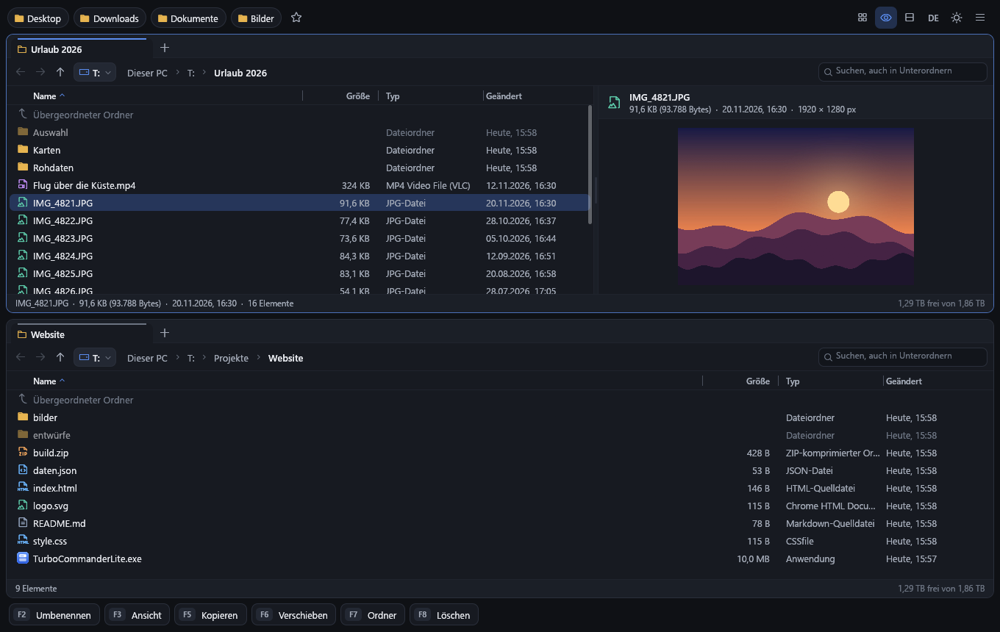
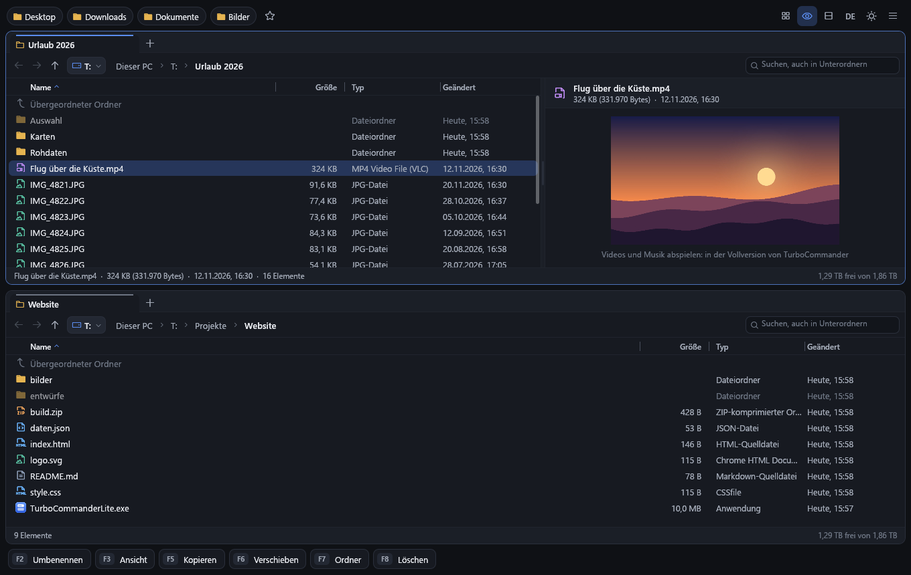
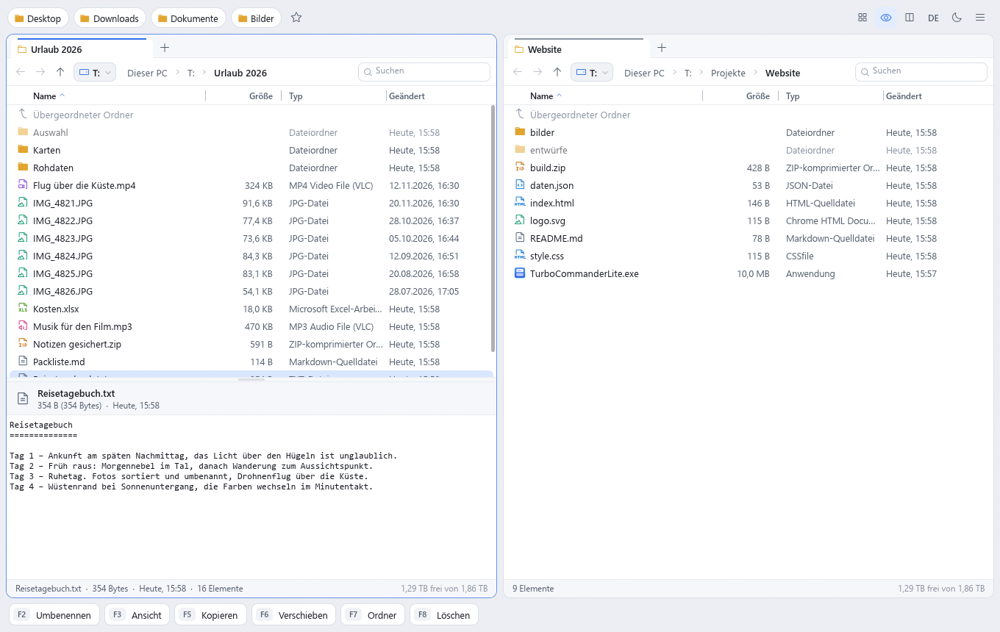
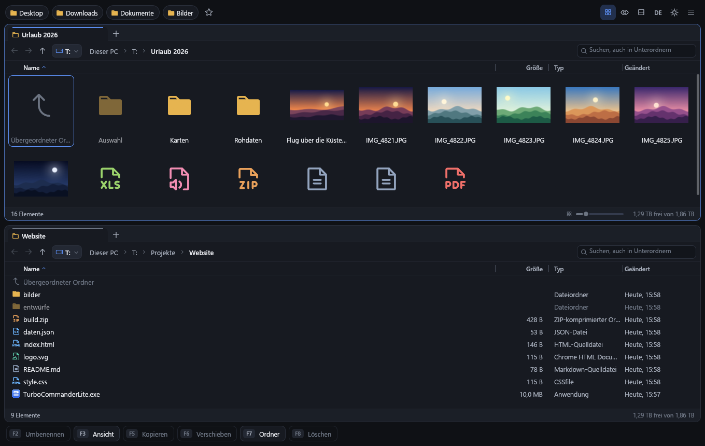
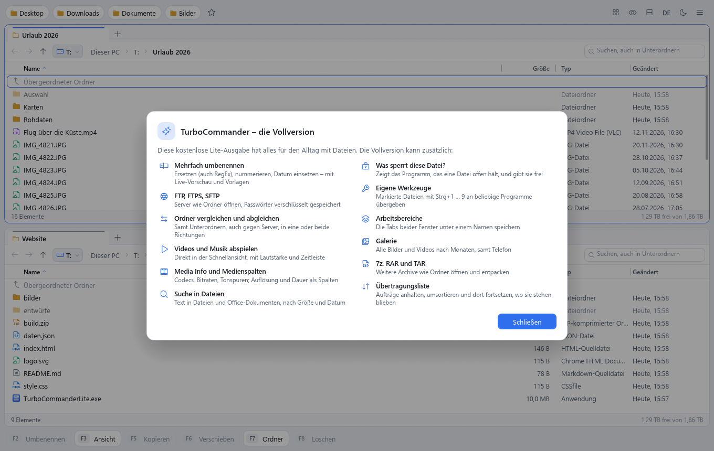

<div align="center">


# TurboCommander Lite

**Die kostenlose Ausgabe von TurboCommander – ein schneller, ruhiger Zwei-Fenster-Dateimanager für Windows, geschrieben in Rust.**

[**Download**](../../releases/latest) · eine einzige `TurboCommanderLite.exe` · keine Installation · Windows 10/11 (64 Bit)

[English](README.md) · Deutsch

</div>



## Was es ist

TurboCommander Lite ist ein Dateimanager in der Tradition der klassischen Zwei-Fenster-Commander, reduziert auf das,
was man täglich wirklich braucht, und darauf ausgelegt, sofort zu reagieren. Er startet in etwa einer
Drittelsekunde, besteht aus einer einzigen Datei von rund 10 MB und lässt das System in Ruhe: keine
Installation, keine Dienste, keine Datenübertragung an irgendwen.

Die Nutzung ist kostenlos. Die **Vollversion von TurboCommander** kann zusätzlich mehrfach umbenennen, FTP/SFTP,
Ordner vergleichen und mehr – siehe [Lite und Vollversion](#lite-und-vollversion).
<!-- Link zur Vollversion (Patreon) hier und in src/edition.rs (FULL_VERSION_URL) eintragen. -->

## Funktionen

- **Zwei Fenster, über- oder nebeneinander** – umschalten mit <kbd>F9</kbd>, Trenner ziehen, Fenster tauschen mit <kbd>Strg</kbd>+<kbd>U</kbd>.
- **Tabs in jedem Fenster** – mit der Maus umsortieren oder ins andere Fenster ziehen.
- **Schnellansicht im selben Fenster** (<kbd>F3</kbd>) – Bilder und Texte, dazu die Vorschau von Windows für alles
  andere (PDF, Office, PSD, Standbilder von Videos, Cover von Musik …). Der Trenner zwischen Liste und Vorschau
  lässt sich ziehen.
- **Miniaturansicht** (<kbd>Strg</kbd>+<kbd>B</kbd>) – zeigt einen Ordner als Raster mit Vorschaubildern statt als
  Liste, je Tab einstellbar. <kbd>Strg</kbd>+Mausrad oder der Regler in der Statuszeile ändert die Größe.
- **Spalten nach Wahl** – ein Rechtsklick auf den Spaltenkopf legt fest, ob Größe, Typ und Datum gezeigt werden; die
  Spalten lassen sich in die gewünschte Reihenfolge ziehen.
- **Suchen beim Tippen** – den aktuellen Ordner sofort filtern oder alle Unterordner durchsuchen (<kbd>Strg</kbd>+<kbd>F</kbd>).
- **Ordnergrößen auf Wunsch** (<kbd>Leertaste</kbd>), leere Ordner erscheinen leicht ausgegraut.
- **Ziehen und Ablegen überall** – zwischen den Fenstern, auf Ordner, aus dem Explorer und hinaus in andere Programme.
  Ein Link aus der Adressleiste des Browsers wird als `.url`-Verknüpfung abgelegt, ein Bild aus einer Webseite als Datei.
- **Netzwerk, OneDrive, Dropbox und das Telefon** direkt neben den Laufwerken – ein über „Link zu Windows"
  verbundenes Telefon öffnet sich wie ein Ordner.
- **Cloud-Status** – in OneDrive, Dropbox und anderen Cloud-Ordnern zeigt jede Datei, ob sie auf dem PC liegt oder nur
  online; „Immer auf diesem PC behalten" und „Speicher freigeben" stehen im Kontextmenü.
- **Papierkorb** – Gelöschtes mit dem ursprünglichen Ort ansehen, wiederherstellen, endgültig löschen oder den
  Papierkorb leeren.
- **Telefone und Kameras am Kabel** (MTP) – unter „Dieser PC" durchsehen und von dort auf den PC kopieren (nur lesen).
- **ZIP-Archive** – wie Ordner durchsuchen, daraus entpacken und als ZIP packen.
- **Rückgängig** (<kbd>Strg</kbd>+<kbd>Z</kbd>) – nimmt das letzte Kopieren, Verschieben, Löschen (aus dem Papierkorb)
  oder Umbenennen zurück, bis zu zwanzig Schritte.
- **Kopieren im Hintergrund** mit Fortschritt, Rückfrage bei vorhandenen Dateien und Abbrechen.
- **Schnellzugriff des Explorers** – seine Ordner werden mit einem Klick zu Favoriten.
- **Umbenennen wie gewohnt** – <kbd>F2</kbd> oder ein zweiter Klick auf den markierten Namen.
- **Echte Programmsymbole** für Programme und Verknüpfungen.
- **Helles und dunkles Design**, **Deutsch und Englisch** – beides jederzeit umschaltbar.
- **Sicherung der Einstellungen** – Favoriten, Spalten und Darstellung.

## Lite und Vollversion

| | Lite | Vollversion |
|---|:---:|:---:|
| Zwei Fenster, Tabs, Schnellansicht, Miniaturen, Suche, ZIP, Rückgängig | ✓ | ✓ |
| Netzwerk, Cloud-Ordner, Telefon, Papierkorb, Geräte am Kabel | ✓ | ✓ |
| Mehrfach umbenennen mit Live-Vorschau und Vorlagen | | ✓ |
| FTP, FTPS und SFTP | | ✓ |
| Ordner vergleichen und abgleichen | | ✓ |
| Videos und Musik in der Schnellansicht abspielen | | ✓ |
| Media Info, Medienspalten (Auflösung, Dauer, Format) | | ✓ |
| Suche in Dateien, nach Größe und Datum | | ✓ |
| „Was sperrt diese Datei?" | | ✓ |
| Eigene Werkzeuge (<kbd>Strg</kbd>+<kbd>1</kbd> … <kbd>9</kbd>) | | ✓ |
| Arbeitsbereiche | | ✓ |
| Galerie aller Bilder und Videos | | ✓ |
| Archive im Format 7z, RAR und TAR | | ✓ |
| Übertragungsliste mit Anhalten und Fortsetzen | | ✓ |

*Menü → Was die Vollversion mehr kann …* zeigt diese Liste auch im Programm.

## Bilder

| | |
|---|---|
|  Schnellansicht mit der Vorschau von Windows |  Nebeneinander, helles Design |
|  Miniaturansicht |  Was die Vollversion mehr kann |

## Loslegen

1. `TurboCommanderLite.exe` aus der [neuesten Version](../../releases/latest) herunterladen.
2. An einen beliebigen Ort legen und starten. Mehr ist nicht nötig.

Windows SmartScreen warnt möglicherweise vor einem unbekannten Herausgeber, weil die Datei nicht signiert ist:
*Weitere Informationen* → *Trotzdem ausführen*.

Die Einstellungen liegen in `%APPDATA%\TurboCommander Lite\config.json` – getrennt von der Vollversion, sodass sich
beide auf demselben PC nutzen lassen. Zum Entfernen genügt es, die exe und diesen Ordner zu löschen.

## Tastenkürzel

| Taste | Aktion | Taste | Aktion |
|---|---|---|---|
| <kbd>Tab</kbd> | Fenster wechseln | <kbd>Strg</kbd>+<kbd>C</kbd> / <kbd>X</kbd> / <kbd>V</kbd> | Kopieren / Ausschneiden / Einfügen |
| <kbd>Enter</kbd> | Öffnen | <kbd>Strg</kbd>+<kbd>A</kbd> | Alles markieren |
| <kbd>Rücktaste</kbd> | Übergeordneter Ordner | <kbd>Einfg</kbd> | Markieren und weiter |
| <kbd>Alt</kbd>+<kbd>←</kbd> / <kbd>→</kbd> | Zurück / Vorwärts | <kbd>Leertaste</kbd> | Markieren, Ordnergröße berechnen |
| <kbd>F2</kbd> | Umbenennen | <kbd>Strg</kbd>+<kbd>F</kbd> | Suchen, auch in Unterordnern |
| <kbd>F3</kbd> oder <kbd>Strg</kbd>+<kbd>Q</kbd> | Schnellansicht | <kbd>Strg</kbd>+<kbd>L</kbd> | Pfad eingeben |
| <kbd>F5</kbd> | Ins andere Fenster kopieren | <kbd>Strg</kbd>+<kbd>T</kbd> / <kbd>W</kbd> | Neuer Tab / Tab schließen |
| <kbd>F6</kbd> | Ins andere Fenster verschieben | <kbd>Strg</kbd>+<kbd>Tab</kbd> | Nächster Tab |
| <kbd>F7</kbd> | Neuer Ordner | <kbd>Strg</kbd>+<kbd>R</kbd> | Aktualisieren |
| <kbd>Umschalt</kbd>+<kbd>F4</kbd> | Neue Datei | <kbd>Strg</kbd>+<kbd>H</kbd> | Versteckte Dateien ein/aus |
| <kbd>F8</kbd> oder <kbd>Entf</kbd> | Löschen (mit <kbd>Umschalt</kbd>: endgültig) | <kbd>Strg</kbd>+<kbd>D</kbd> | Ordner zu Favoriten |
| <kbd>F9</kbd> | Fenster über-/nebeneinander | <kbd>Strg</kbd>+<kbd>U</kbd> | Fenster tauschen |
| <kbd>Alt</kbd>+<kbd>Enter</kbd> | Eigenschaften | <kbd>Strg</kbd>+<kbd>Z</kbd> | Kopieren, Verschieben, Löschen, Umbenennen rückgängig |
| <kbd>Esc</kbd> | Markierung / Filter aufheben | <kbd>Strg</kbd>+<kbd>B</kbd> | Miniaturansicht |

<kbd>F1</kbd> zeigt diese Liste im Programm.

## Gut zu wissen

- **Standbilder von Videos**: Bei Videos zeigt die Schnellansicht die Vorschau, die Windows für die Datei hat. Für
  Formate ohne Vorschau von Windows (ProRes, DNxHR …) zeigt TurboCommander Lite ein Standbild, sofern `ffmpeg` im
  Suchpfad (`PATH`) liegt.
- **Keine Datenübertragung, keine Update-Prüfung.** Netzwerkverbindungen entstehen nur zu den Freigaben, die man
  selbst öffnet.

## Selbst bauen

Benötigt wird eine aktuelle stabile Rust-Toolchain mit MSVC (entwickelt wird mit Rust 1.99).

```
cargo build --release
```

Das Ergebnis ist `target\release\TurboCommanderLite.exe`. `cargo test` führt die Tests aus.

TurboCommander Lite entsteht mit [egui](https://github.com/emilk/egui) (gezeichnet mit OpenGL),
[Phosphor Icons](https://phosphoricons.com) und dem Crate `zip`.

Was neu ist, steht im [Änderungsprotokoll](CHANGELOG.md).

## Lizenz

TurboCommander Lite steht unter der [MIT-Lizenz](LICENSE).

Die Bilder auf dieser Seite erzeugt `tools\screenshots.ps1`.
