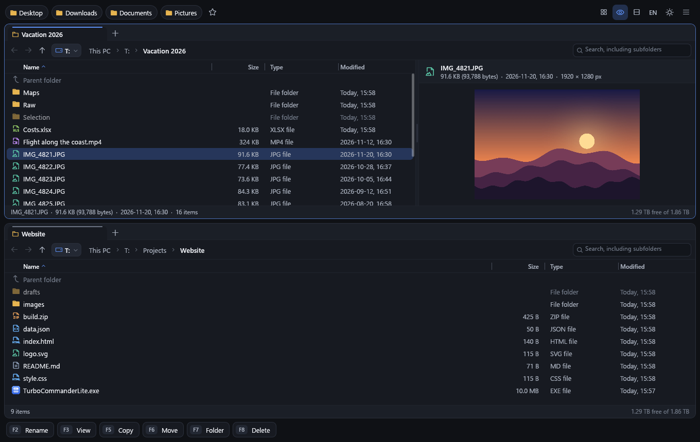
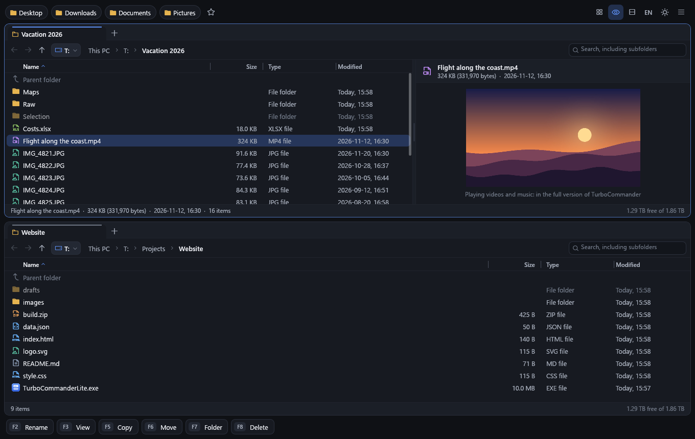
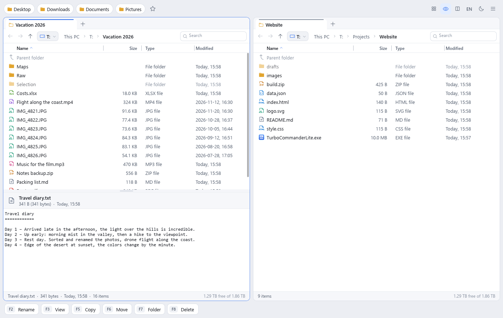
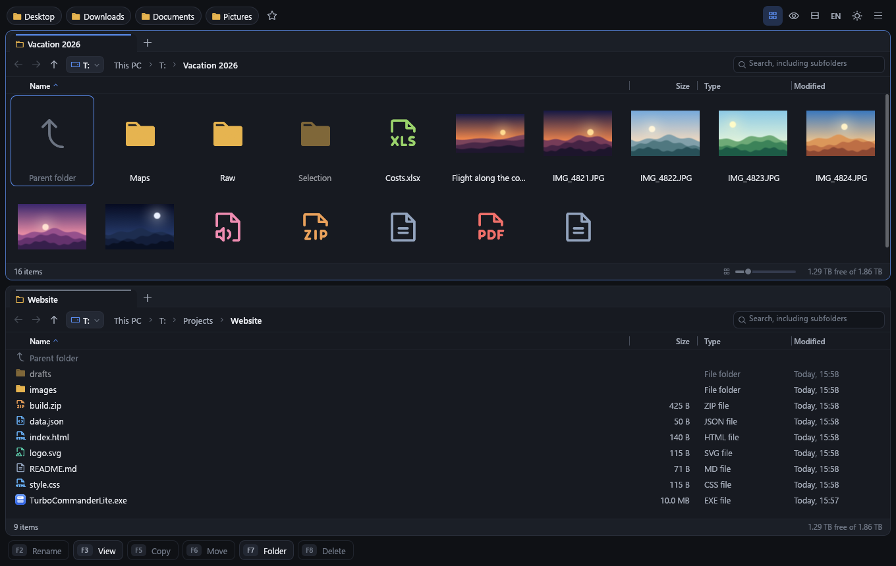
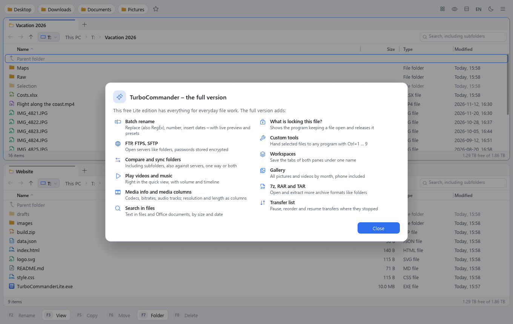

<div align="center">


# TurboCommander Lite

**The free edition of TurboCommander – a fast, calm dual-pane file manager for Windows, written in Rust.**

[**Download**](../../releases/latest) · one `TurboCommanderLite.exe` · no installer · Windows 10/11 (64-bit)

English · [Deutsch](README.de.md)

</div>



## What it is

TurboCommander Lite is a file manager in the tradition of the classic two-pane commanders, reduced to what you
actually use every day and built to feel instant. It starts in about a third of a second, is a single executable
of about 10 MB and keeps its hands off your system: no installer, no services, no telemetry.

It is free to use. The **full version of TurboCommander** adds batch rename, FTP/SFTP, folder compare and more –
see [Lite and full version](#lite-and-full-version).
<!-- Link zur Vollversion (Patreon) hier und in src/edition.rs (FULL_VERSION_URL) eintragen. -->

## Features

- **Two panes, stacked or side by side** – switch with <kbd>F9</kbd>, drag the divider, swap panes with <kbd>Ctrl</kbd>+<kbd>U</kbd>.
- **Tabs in every pane** – drag them to reorder or drop them into the other pane.
- **Quick view inside the pane** (<kbd>F3</kbd>) – images and text, plus the Windows previews for everything else
  (PDF, Office, PSD, video stills, album covers …). The divider between list and preview is draggable.
- **Thumbnail view** (<kbd>Ctrl</kbd>+<kbd>B</kbd>) – shows a folder as a grid of previews instead of a list, set per
  tab. <kbd>Ctrl</kbd>+mouse wheel or the slider in the status bar changes the thumbnail size.
- **Columns of your choice** – right-click the column header to choose size, type and date and drag them into the
  order you like.
- **Search as you type** – filter the current folder instantly or search through all subfolders (<kbd>Ctrl</kbd>+<kbd>F</kbd>).
- **Folder sizes on demand** (<kbd>Space</kbd>), empty folders are shown dimmed.
- **Drag & drop everywhere** – between panes, onto folders, from Explorer, and out into other programs. A link
  dragged from the browser's address bar is stored as a `.url` shortcut, a picture from a web page as a file.
- **Network, OneDrive, Dropbox and your phone** right next to your drives – a phone connected through *Link to
  Windows* opens like a folder.
- **Cloud status** – in OneDrive, Dropbox and other cloud folders every file shows whether it is on the PC or only
  online; *Always keep on this PC* and *Free up space* are in the context menu.
- **Recycle Bin** – view deleted items with their original location, restore them, delete them for good, or empty
  the bin.
- **Phones and cameras on a cable** (MTP) – browse them under “This PC” and copy from them to the PC (read-only).
- **ZIP archives** – browse them like folders, extract from them and pack as ZIP.
- **Undo** (<kbd>Ctrl</kbd>+<kbd>Z</kbd>) – takes back the last copy, move, delete (from the Recycle Bin) or rename, up
  to twenty steps.
- **Copying in the background** with progress, conflict questions and cancel.
- **Explorer's Quick access** – its folders become favorites with one click.
- **Rename the way you expect** – <kbd>F2</kbd>, or click a selected name again.
- **Real program icons** for executables and shortcuts.
- **Light and dark theme**, **English and German** – both switchable at any time.
- **Backup of all settings** – favorites, columns and appearance.

## Lite and full version

| | Lite | Full version |
|---|:---:|:---:|
| Two panes, tabs, quick view, thumbnails, search, ZIP, undo | ✓ | ✓ |
| Network, cloud folders, phone, Recycle Bin, devices on a cable | ✓ | ✓ |
| Batch rename with live preview and presets | | ✓ |
| FTP, FTPS and SFTP | | ✓ |
| Compare and sync folders | | ✓ |
| Play videos and music in the quick view | | ✓ |
| Media Info, media columns (resolution, length, format) | | ✓ |
| Search inside files, by size and by date | | ✓ |
| *What is locking this file?* | | ✓ |
| Custom tools (<kbd>Ctrl</kbd>+<kbd>1</kbd> … <kbd>9</kbd>) | | ✓ |
| Workspaces | | ✓ |
| Gallery of all pictures and videos | | ✓ |
| 7z, RAR and TAR archives | | ✓ |
| Transfer list with pause and resume | | ✓ |

*Menu → What the full version adds …* shows the same list inside the program.

## Screenshots

| | |
|---|---|
|  Quick view with the Windows preview |  Side by side, light theme |
|  Thumbnail view |  What the full version adds |

## Getting started

1. Download `TurboCommanderLite.exe` from the [latest release](../../releases/latest).
2. Put it wherever you like and start it. That's all.

Windows SmartScreen may warn about an unknown publisher because the file is not code-signed:
choose *More info* → *Run anyway*.

Settings are stored in `%APPDATA%\TurboCommander Lite\config.json` – separate from the full version, so both can
be used on the same PC. To remove TurboCommander Lite, delete the exe and that folder.

## Keyboard shortcuts

| Key | Action | Key | Action |
|---|---|---|---|
| <kbd>Tab</kbd> | Switch pane | <kbd>Ctrl</kbd>+<kbd>C</kbd> / <kbd>X</kbd> / <kbd>V</kbd> | Copy / Cut / Paste |
| <kbd>Enter</kbd> | Open | <kbd>Ctrl</kbd>+<kbd>A</kbd> | Select all |
| <kbd>Backspace</kbd> | Parent folder | <kbd>Ins</kbd> | Select and move on |
| <kbd>Alt</kbd>+<kbd>←</kbd> / <kbd>→</kbd> | Back / Forward | <kbd>Space</kbd> | Select, calculate folder size |
| <kbd>F2</kbd> | Rename | <kbd>Ctrl</kbd>+<kbd>F</kbd> | Search, including subfolders |
| <kbd>F3</kbd> or <kbd>Ctrl</kbd>+<kbd>Q</kbd> | Quick view | <kbd>Ctrl</kbd>+<kbd>L</kbd> | Enter a path |
| <kbd>F5</kbd> | Copy to other pane | <kbd>Ctrl</kbd>+<kbd>T</kbd> / <kbd>W</kbd> | New tab / Close tab |
| <kbd>F6</kbd> | Move to other pane | <kbd>Ctrl</kbd>+<kbd>Tab</kbd> | Next tab |
| <kbd>F7</kbd> | New folder | <kbd>Ctrl</kbd>+<kbd>R</kbd> | Refresh |
| <kbd>Shift</kbd>+<kbd>F4</kbd> | New file | <kbd>Ctrl</kbd>+<kbd>H</kbd> | Show / hide hidden files |
| <kbd>F8</kbd> or <kbd>Del</kbd> | Delete (with <kbd>Shift</kbd>: permanently) | <kbd>Ctrl</kbd>+<kbd>D</kbd> | Add folder to favorites |
| <kbd>F9</kbd> | Panes stacked / side by side | <kbd>Ctrl</kbd>+<kbd>U</kbd> | Swap panes |
| <kbd>Alt</kbd>+<kbd>Enter</kbd> | Properties | <kbd>Ctrl</kbd>+<kbd>Z</kbd> | Undo copy, move, delete, rename |
| <kbd>Esc</kbd> | Clear selection / filter | <kbd>Ctrl</kbd>+<kbd>B</kbd> | Thumbnail view |

<kbd>F1</kbd> shows this list inside the program.

## Good to know

- **Video stills**: for videos the quick view shows the preview Windows has for the file. For formats Windows has
  no preview for (ProRes, DNxHR …) TurboCommander Lite shows a still frame if `ffmpeg` is available on the `PATH`.
- **No telemetry, no update checks.** The only network connections are the network shares you open.

## Building from source

You need a recent stable Rust toolchain with the MSVC target (the project is developed with Rust 1.99).

```
cargo build --release
```

The result is `target\release\TurboCommanderLite.exe`. `cargo test` runs the test suite.

TurboCommander Lite is built with [egui](https://github.com/emilk/egui) (rendered with OpenGL),
[Phosphor Icons](https://phosphoricons.com) and the `zip` crate.

See the [changelog](CHANGELOG.md) for what is new.

## License

TurboCommander Lite is released under the [MIT License](LICENSE).

The screenshots on this page are generated with `tools\screenshots.ps1`.
